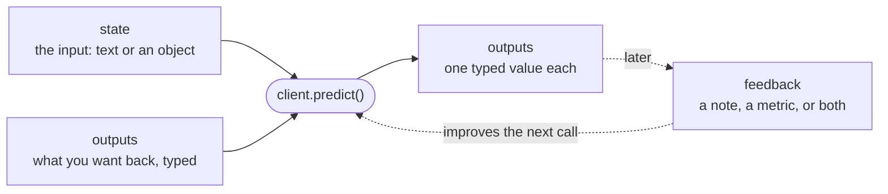

This guide covers four ways to use tracehill: have your coding agent use the tracehill skill, use the Python SDK, call the HTTP API, or try the in-browser API playground.

<Note>
  The examples assume `TRACEHILL_URL` is set to the URL of your tracehill API. The SDK and the agent skill both read it.
</Note>

## The minimum you should know

A tracehill request has a **state** (the input: a string or a JSON object) and a set of **outputs** (what you want back, each with a type). The response has one typed value per output, plus an `id` you can attach **feedback** to. tracehill learns from that feedback, so later calls of the same task get better.



Each output has one of these types:

| Type | Use it to | Returns |
|---|---|---|
| `Text` | Write something | a string |
| `Bool` | Decide yes or no | `true` / `false` |
| `Choice` | Pick one label from a fixed set | one of your labels |
| `Integer`, `Number` | Rate or count | a number |
| `List` | Extract several items | a list of strings |
| `Json` | Return structured data | an object |

[Output types](/concepts/output-types) covers each one in detail.

## Vibe it: the agent skill

The fastest way to add tracehill to a project is to let your coding agent write the integration, with the tracehill skill installed. The skill teaches the agent how to describe tasks, choose output types, store prediction ids and send feedback.

<Tabs>
  <Tab title="Claude Code">
    Install the skill into your project:

    ```bash
    npx skills add Ziems/tracehill --skill tracehill
    ```

    Or copy `skills/tracehill/SKILL.md` from the tracehill repo into `.claude/skills/tracehill/` in your project, or into `~/.claude/skills/tracehill/` to use it everywhere.
  </Tab>
  <Tab title="Other agents">
    `npx skills add` also installs the skill for other agents that support skills:

    ```bash
    npx skills add Ziems/tracehill --skill tracehill
    ```

    For agents without skill support, add the contents of `SKILL.md` to the agent's instructions file, for example `AGENTS.md`.
  </Tab>
</Tabs>

Then ask your agent to build with it:

```text Coding agent prompt
Let's build a small CLI that triages support tickets with
tracehill: for each ticket, pick the team, rate how frustrated
the customer is, and flag whether it's urgent. Use the tracehill
skill. Store each prediction id so we can send feedback once a
ticket is resolved. Ask me what teams we have and how tickets
arrive.
```

## Code it: your first prediction

Make a working directory. These commands use Bash on macOS, Linux, or Windows with WSL:

```bash
mkdir tracehill-quickstart
cd tracehill-quickstart
```

The example sends one customer-support ticket and asks three things about it in a single request: which team should handle it, how frustrated the customer is, and whether it's urgent.

<Tabs>
  <Tab title="Python">
    Requires Python 3.13 or later. Install the SDK with either package manager:

    <CodeGroup>
    ```bash pip
    python3 -m venv .venv
    .venv/bin/pip install tracehill
    ```

    ```bash uv
    uv init --bare
    uv add tracehill
    ```
    </CodeGroup>

    Save this as `route_ticket.py`:

    ```python route_ticket.py
    import tracehill as th

    ticket = (
        "Our API integration started returning 500 errors on every request about "
        "20 minutes ago, and we can't process any customer orders until it's fixed."
    )

    with th.Client() as client:  # Reads TRACEHILL_URL.
        result = client.predict(
            state={"ticket": ticket},
            outputs={
                "department": th.Choice(
                    {
                        "billing": "Payment or subscription issues",
                        "technical": "Bugs or integration problems",
                        "sales": "Pricing or account questions",
                    },
                    instructions="Which team should handle this",
                ),
                "frustration": th.Integer(
                    instructions="How frustrated the customer is: 0 calm, 1 frustrated but civil, 2 very angry",
                ),
                "is_urgent": th.Bool(
                    instructions="Does the message convey urgency or time pressure?",
                ),
            },
            instructions="Triage an incoming support ticket.",
        )

    print(result["department"])
    print(result["frustration"])
    print(result["is_urgent"])
    print(result.id)
    ```

    Run it with whichever package manager you used:

    <CodeGroup>
    ```bash pip
    .venv/bin/python route_ticket.py
    ```

    ```bash uv
    uv run route_ticket.py
    ```
    </CodeGroup>
  </Tab>

  <Tab title="Bash">
    Requires `curl`. The request is plain JSON; each output names its `type`.

    ```bash
    curl -s "$TRACEHILL_URL/predict" \
      -H "Content-Type: application/json" \
      -d '{
        "instructions": "Triage an incoming support ticket.",
        "state": {
          "ticket": "Our API integration started returning 500 errors on every request about 20 minutes ago, and we cannot process any customer orders until it is fixed."
        },
        "outputs": {
          "department": {
            "type": "choice",
            "instructions": "Which team should handle this",
            "options": {
              "billing": "Payment or subscription issues",
              "technical": "Bugs or integration problems",
              "sales": "Pricing or account questions"
            }
          },
          "frustration": {
            "type": "integer",
            "instructions": "How frustrated the customer is: 0 calm, 1 frustrated but civil, 2 very angry"
          },
          "is_urgent": {
            "type": "bool",
            "instructions": "Does the message convey urgency or time pressure?"
          }
        }
      }'
    ```
  </Tab>
</Tabs>

tracehill answers every output from the same state and returns each value under the name you gave it. `department` is one of your three labels, `frustration` is an integer on your 0–2 scale, and `is_urgent` is a real boolean. The Python example prints:

```text Example output
technical
1
True
pred_01KA3Q7Z8M2N4P6R8T0V2X4Z6B
```

The Bash example prints the raw JSON response, shown in the next section. Your values may differ; these are example results.

## Close the loop: send feedback

When you find out how the prediction worked out, for example when an agent reassigns the ticket or the customer replies, attach feedback to it. Send a note, a metric, or both, as often as you like.

<CodeGroup>
```python Python
# Inside the `with th.Client() as client:` block in route_ticket.py
result.feedback(
    feedback="Right team, but the customer was angrier than rated",
    metric=0.7,
)
```

```bash Bash
curl -s "$TRACEHILL_URL/predictions/pred_01KA3Q7Z8M2N4P6R8T0V2X4Z6B/feedback" \
  -H "Content-Type: application/json" \
  -d '{"feedback": "Right team, but the customer was angrier than rated", "metric": 0.7}'
```
</CodeGroup>

Over HTTP, feedback goes to the prediction's `id`. tracehill groups feedback by task and uses it right away to improve that task's next calls; see [Feedback](/concepts/feedback).

## Call it: the API

The SDK and the Bash example both use this endpoint:

```http
POST {TRACEHILL_URL}/predict
Content-Type: application/json
```

<Accordion title="Raw response">
```json
{
  "id": "pred_01KA3Q7Z8M2N4P6R8T0V2X4Z6B",
  "signature_id": "sig_4be17c09a2f3d865",
  "outputs": {
    "department": "technical",
    "frustration": 1,
    "is_urgent": true
  }
}
```
</Accordion>

The [API reference](/api-reference/introduction) lists every endpoint, request field and error.

## Try it: the API playground

You can run a prediction in your browser without writing code.

<Steps>
  <Step title="Open the playground">
    Go to [Run a prediction](/api-reference/run-a-prediction) and select **Try it**.
  </Step>
  <Step title="Check where it sends requests">
    The playground calls `http://localhost:8000`, so run it with a tracehill server on your machine.
  </Step>
  <Step title="Send a state and one output">
    Use any text as the state, and start with a single `bool` output:

    ```json
    {
      "state": "Our API integration started returning 500 errors on every request about 20 minutes ago.",
      "outputs": {
        "is_urgent": {"type": "bool", "instructions": "Does this message express urgency?"}
      }
    }
    ```
  </Step>
  <Step title="Add more outputs">
    Combine `choice`, `integer`, `text` and other outputs in one request, and see every answer at once.
  </Step>
</Steps>

## Next steps

<CardGroup cols={2}>
  <Card title="Describing tasks" icon="list-check" href="/concepts/tasks">
    How `state`, `outputs` and `instructions` work, and what a `signature_id` is.
  </Card>
  <Card title="Output types" icon="shapes" href="/concepts/output-types">
    All seven types, with examples.
  </Card>
  <Card title="Feedback" icon="comments" href="/concepts/feedback">
    What to send, and how it's grouped.
  </Card>
  <Card title="Python SDK" icon="python" href="/sdk/python">
    The full client reference.
  </Card>
</CardGroup>
